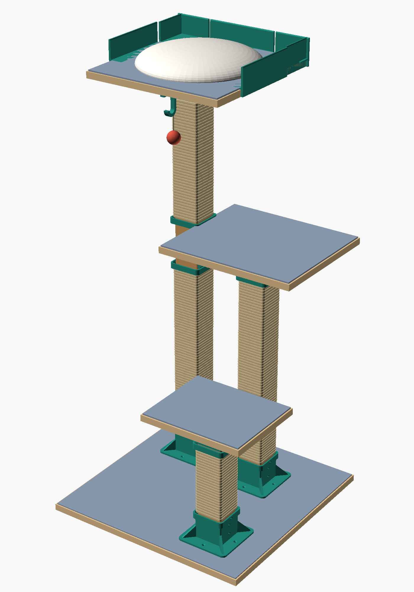
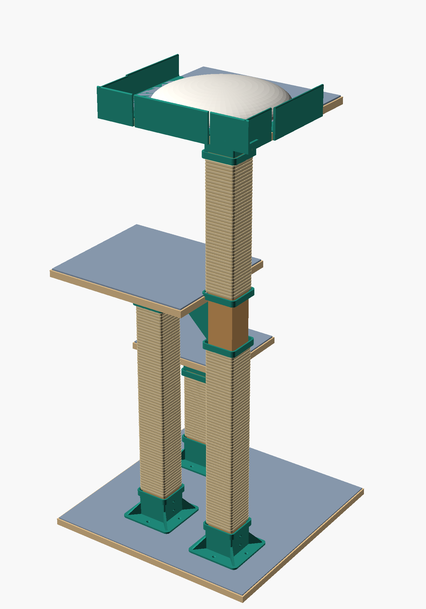
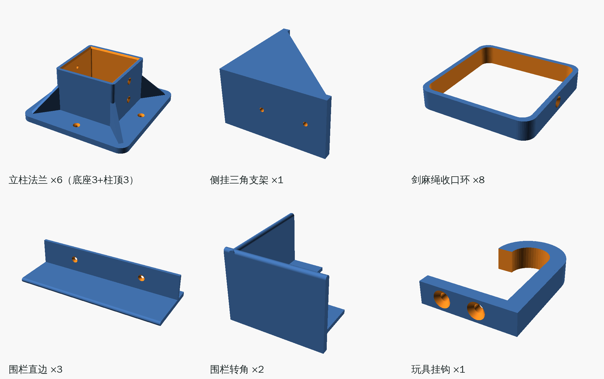

# 落地式猫爬架（70×70 方木 + 18mm 多层板 + 打印连接件）

适合 5kg 左右的猫，总高约 120cm，三层：40cm 小跳台、75cm 中层、120cm 顶层猫窝。





## 文件
- `cat_tree_parts.scad`：所有打印件，参数在文件开头（方木尺寸、间隙、板厚、绳径等）
- `assembly.scad`：整体装配预览，只用来看效果
- `stl/`：已按打印方向导出好的 STL，可以直接拖进切片软件

改尺寸后重新导出：
```bash
openscad -D 'part="post_mount"' -o stl/post_mount.stl cat_tree_parts.scad
```

## 打印清单（PETG）

| 零件 | 数量 | 尺寸 (mm) | 打印方向 / 支撑 |
|---|---|---|---|
| post_mount 立柱法兰 | 6 | 150×150×68 | 底板贴热床，免支撑 |
| side_bracket 侧挂支架 | 1 | 110×110×60 | 已经侧躺放好，免支撑 |
| rope_collar 收口环 | 8 | 95×95×16 | 免支撑 |
| rim_straight 围栏直边 | 3 | 200×76×40 | 外侧面贴热床，免支撑 |
| rim_corner 围栏转角 | 2 | 100×100×76 | 正立打印，压片下方要加支撑 |
| toy_hook 玩具挂钩 | 1 | 50×64×12 | 免支撑 |

全部打完大约 2kg PETG（法兰最重，6 个约 1.2kg），围栏是可选件，不打的话约 1.5kg。

切片参数：0.2mm 层高、5 圈外壁、顶底各 5 层、40–50% gyroid 填充。

## 木料清单
- 底座：18mm 多层板 600×600 ×1
- 平台：18mm 多层板 400×400、400×350、300×250 各 1
- 立柱：70×70 方木 **1150、700、350mm** 各 1（让店家切好，端面要平）
- 剑麻绳 8mm 约 70m（缠绕总长约 1.6m，每 8mm 高要绕一圈约 31cm）
- 地毯或毛毡约 1m×1m
- 沉头木螺丝：4×16 ×15、4×20 ×20、4×25 ×25、4×40 ×30（已含备用）
- 防倾倒绑带 1 套

## 组装要点
1. 先打一个法兰试装方木。太紧就把 `clr` 从 0.5 改到 0.7，太松就改到 0.3
2. 法兰底板用 4×25 木螺丝固定在底座上（不要用 4×30，会从底座下面穿出来），侧面用 4×40 拧进立柱
3. 柱顶法兰倒过来套上，平台放在上面，从下往上拧 4×20 木螺丝（板厚 18mm，螺丝不要超过 24mm，否则会顶穿）
4. 主柱 **640–735mm** 这一段先不缠绳，用来装侧挂支架
5. 缠好剑麻绳后，用收口环压住两端（4×25 木螺丝），绳头用钉子或热熔胶固定
6. 靠墙摆好，用防倾倒绑带把主柱顶部和墙连起来
